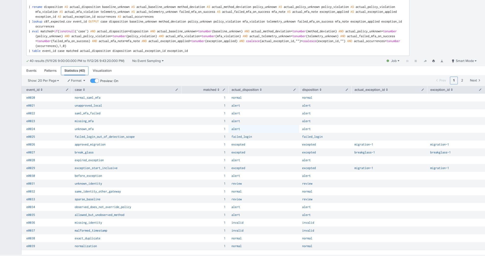
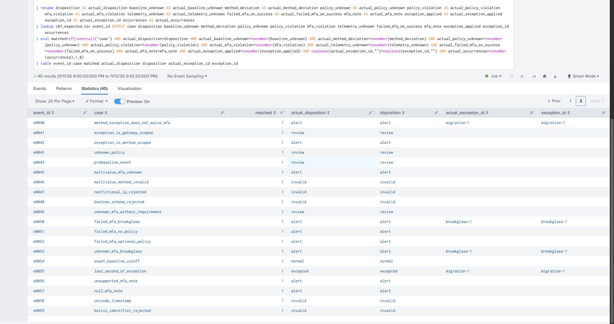

# Remote Access Authentication Detection Lab

Licensed under the [MIT License](LICENSE).

A synthetic detection-engineering lab for successful remote-gateway logins that deviate from a frozen authentication baseline or explicit policy. MFA evidence is evaluated separately from the authentication method: SAML alone does not establish MFA.

---

## Executive Summary

**Problem.** A successful login can use an unexpected authentication method or lack required MFA evidence. Learning a baseline from the same traffic being evaluated can hide the deviation.

**What I built.** A deterministic event generator, a frozen training baseline, explicit policy and time-bounded exception lookups, a Python reference evaluator, and a matching Splunk search.

**What validation shows.** The offline suite has 27 tests and 40 unique cases. Default and alternate Splunk exports matched all 40 IDs and all 15 reference output fields. Benign logins, policy violations, MFA failures, exceptions and invalid telemetry have explicit outcomes.

**Scope.** Synthetic, normalized CSV inputs only. No raw-vendor parser, production ingestion or enabled scheduled alert is shipped. Findings are investigation indicators, not proof of MFA bypass or CVE exploitation.

### Results

| Check | Result | Evidence |
|---|---|---|
| Offline tests | 27 passing tests | [Test suite](tests/test_detection.py) |
| Fixtures | 40 unique cases from 41 raw records | [Expected outcomes](fixtures/expected.json) |
| Manual Splunk parity | 40/40 cases in both default and alternate datasets | [CSV appendix](docs/results/README.md) |
| Diagnostics | 40 matching rows per dataset | Alternate dataset screenshots in Appendix A; [evidence status](docs/validation.md) |
| CI | Python 3.10/3.12 validation and Gitleaks configured; check the run for each commit | [GitHub Actions](https://github.com/Olaoluwa-byte/remote-access-auth-detection-lab/actions) |

### Coverage & Limitations

| Boundary | Impact |
|---|---|
| Trusted normalized input | Arbitrary raw gateway logs are not supported |
| Frozen baseline and explicit policy | Evaluation traffic cannot teach itself into the baseline |
| Scoped exceptions | Failed MFA on a schema-valid successful login cannot be waived |
| Invalid telemetry | Separate triage is required; invalid is not normal |
| Lookup integrity | Python rejects duplicate keys; SPL requires manual preflight |
| Execution provenance | Fresh capture retained privately; lookup binding is partly corroborated by metadata, not explicit paths |

[Detection SPL](detections/c07_auth_deviation.spl) · [Validation procedure](docs/splunk-validation.md) · [Evidence status](docs/validation.md) · [Operational limitations](docs/review-disposition.md)

---

## Appendix

<details>
<summary><b>A. Splunk screenshots and example outcomes</b></summary>

These are screenshots of the retained alternate-dataset diagnostic search in Splunk, captured on 2026-11-13 UTC. Each page shows 20 of the 40 cases, with `matched=1` indicating agreement with the expected diagnostic fields. Full ID-set and 15-field comparisons are recorded separately in the [validation evidence](docs/validation.md).

### Benign, suspicious and approved-exception outcomes



Normal SAML+MFA is `normal`; unapproved local login and missing/failed MFA are `alert`; approved migration and break-glass examples are `excepted`. Unknown identity and sparse baseline remain `review`.

### MFA failures and exception boundaries



Failed MFA remains `alert` under break-glass, missing policy and optional-MFA policy. The final second inside an exception is `excepted`; invalid Unicode inputs remain `invalid`.

The images show synthetic case IDs and results only. Browser chrome, account controls and server addresses are outside the captured viewport. No result cells were edited. These views illustrate the retained search; they are not new runs or a substitute for full provenance evidence. See [screenshot provenance](docs/images/README.md).

</details>

<details>
<summary><b>B. Quick start and fixture reproduction</b></summary>

Run from the repository root in a terminal:

```bash
python3 -m unittest discover -s tests -v
python3 -m c07.validate --root . --output build
PYTHONPYCACHEPREFIX="$PWD/build/pycache" python3 -m py_compile c07/*.py tests/*.py
```

`-m` runs a module with the repository on its import path. `unittest discover`
finds tests in `tests`; `-v` prints each test result. `c07.validate` compares every
fixture with independently specified expectations and writes `build/acceptance.json`,
`actual.json`, and two CSVs for later Splunk verification. `py_compile` checks syntax.
None of these commands contacts the lab or an external service.

Expected fixture coverage: **40 unique cases in 41 input records**, including one
exact duplicate. The acceptance exit code is nonzero for a mismatch or invalid
input. Invalid JSON, missing event IDs and conflicting duplicates fail the entire
batch instead of silently dropping evidence. Stale files may remain in an output
directory after a failed run: rely on the command exit code and a new empty output
directory for evidence, never an older acceptance.json alone.

To reproduce or explore fixtures in a NEW directory:

```bash
python3 -m c07.generate --output build/new-fixtures --seed 7 --reference-time 2026-11-12T12:00:00Z
python3 -m c07.validate --root build/new-fixtures --output build/new-results
```

The generator refuses an output with existing `fixtures` or `lookups` directories.
The fixed seed controls fictional source addresses; fixed reference time controls
training, evaluation and exception times. This avoids dependency on current VM
clock health. Reproduction of committed fixtures requires the documented defaults.

</details>

<details>
<summary><b>C. Pipeline and trust boundary</b></summary>

1. `fixtures/training.jsonl`: separate, operator-trusted synthetic history.
2. `lookups/c07_baseline.csv`: frozen successful-login history by **gateway + user**.
3. `lookups/c07_policy.csv`: separately authored allowed methods and MFA requirement.
4. `lookups/c07_exceptions.csv`: explicitly approved, time-limited changes/recovery.
5. `fixtures/evaluation.jsonl` passes through the strict offline adapter in
   `model.prepare`. Its exported CSV is the input contract for the SPL query.
6. Reference evaluator and runnable SPL independently express the decision rules.
   `fixtures/expected.json` is ground truth used only by validation, not detection.

**The SPL consumes trusted normalized CSV, not arbitrary raw gateway logs.** The
adapter validates schema/types, canonicalizes identifiers, checks UTC timestamps,
rejects conflicting duplicates, and records unknown MFA. It emits no policy,
baseline, disposition or test-label fields. Upload ONLY the generated CSV and the
validated lookups in a separately approved manual Splunk phase. Do not point this
query at unvalidated event-supplied `valid`, `mfa_known` or `event_epoch` fields.
A production parser, source-specific logging assessment and indexed-data search
are future work. Raw-vendor extraction is not verified. Supplied exports from manual Splunk runs corroborate synthetic decision parity; complete execution provenance remains open (see [validation evidence](docs/validation.md)).

The detection projects input fields before lookup to discard injected decision
fields. Lookup outputs use separate names and are always overwritten by the
lookup. Missing lookup files or corrupt tables invalidate a run; never interpret
partial Splunk results or lookup warnings as a passing test.

</details>

<details>
<summary><b>D. Schema and normalization</b></summary>

All events use schema_version **integer 1** (booleans are rejected) and these fields:

| Field | Contract |
|---|---|
| event_id, session_id | ASCII identifier, 1–96 chars, alphanumeric initial then alphanumeric/underscore/dot/hyphen |
| event_time | ASCII digits, valid whole-second UTC `YYYY-MM-DDTHH:MM:SSZ`; no local time or fractional precision |
| gateway_id, user | Reject raw non-ASCII first, strip ASCII whitespace, lowercase; ASCII alphanumeric initial; remaining alphanumeric/underscore/dot/@/hyphen, maximum 64 chars |
| src_ip | IPv4 documentation ranges only: 192.0.2.0/24, 198.51.100.0/24, 203.0.113.0/24 |
| result | success or failure; scalar string, stripped/lowercased |
| auth_method | saml, local, oidc, certificate; scalar string, stripped/lowercased |
| mfa_result | passed, failed, not_performed, unknown; scalar string, stripped/lowercased |

Missing, multivalued or unsupported MFA becomes `unknown`, never `passed`.
`mfa_note` is bounded: `none`, `missing`, `explicit_unknown`, `unsupported`, or
`wrong_type`. It preserves the distinction without exporting arbitrary input text.
Scalar enum tokens must be ASCII before stripping/lowercasing. SPL adds a defensive
`contract_missing_note` code for a missing/invalid adapter note; that signals a
contract defect during live validation, not a valid adapter output.
Other missing/invalid fields produce `invalid`; unusable event IDs fail the batch.
Additional event fields are rejected, including forged policy decisions and labels.
The deliberately invalid fixtures test these rules. Only the valid fixtures are
claimed to satisfy the schema. Adapter output preserves one row per event ID and
counts identical duplicates in `occurrences`. Conflict means any difference in
canonical JSON content, including an identity change; the entire batch fails.
Identity lowercasing is a lab assumption, not appropriate for every real system.

</details>

<details>
<summary><b>E. Detection rules and exceptions</b></summary>

A history is usable only when its distinct successful training count reaches
`minimum_samples` in the frozen baseline CSV (default **3**). The generator's
`MIN_SAMPLES` supplies that field; Python and SPL both read the field, so SPL has no
separate hard-coded threshold. Lookup write access is a trust boundary: values of 1 or greater are accepted, so an operator can lower the default threshold. Protect and review changes to lookup data; this is not a hard security floor. It also requires
an event time at or after the baseline cutoff. Training must precede cutoff;
failed training logins do not teach the baseline. A successful training login with
explicit failed MFA rejects the training batch. Known `not_performed` remains
eligible for legitimately non-MFA methods; unknown MFA remains ineligible. Duplicate training records do not
increase sample counts. This small threshold is pedagogical, not statistically
validated. Baselines do not age out automatically in revision 1; production use
would require a reviewed refresh/expiry process.

For valid successful events, independent flags are calculated:

| Flag | Meaning |
|---|---|
| baseline_unknown | No history, too few samples or event before frozen cutoff |
| method_deviation | Method not observed in usable trusted history |
| policy_unknown | No explicit gateway/user policy |
| policy_violation | Method disallowed by explicit policy, even if historically observed |
| mfa_violation | Policy requires MFA, but event does not report passed |
| telemetry_unknown | Actual MFA result missing/unsupported/unknown |
| failed_mfa_on_success | Successful login explicitly reports failed MFA; independent of policy/history and never waived |

Exceptions match **gateway + user + auth_method**. Start is inclusive; end is
exclusive, evaluated against event time. `allow_method` and `waive_mfa` are separate
permissions. `waive_mfa` covers only explicit `not_performed`, never `failed` or
`unknown`. Schema-valid successful failed-MFA events always alert, including unknown policy and
optional-MFA policy. One exception interval per key is supported; duplicate keys fail
validation, even for disjoint intervals. An exception needs an existing policy,
ID, reason and valid interval. It cannot invent a baseline or convert unknown MFA
telemetry to known evidence. Exception metadata is emitted only when it actually
waives a finding; it can coexist with a remaining alert.

Disposition precedence:

1. Invalid core schema → `invalid`, without behavioral claims.
2. Failed authentication → `failed_login`, outside successful-login detection scope.
3. Explicit failed MFA on success, or any unwaived method or required-MFA violation → `alert`.
4. Otherwise unknown baseline/policy/MFA evidence → `review`.
5. Otherwise an applied exception → `excepted` (underlying flags retained).
6. Otherwise → `normal`.

The evaluator never updates lookup files. Current observed behavior cannot override
explicit policy. A policy-permitted new method can still be a historical deviation
until a scoped exception or separately reviewed baseline update permits it.

</details>

<details>
<summary><b>F. Evidence, limitations and future work</b></summary>

See [validation evidence](docs/validation.md) and the [manual validation procedure](docs/splunk-validation.md). The default and alternate exported results each matched all 40 IDs and output fields. Fresh per-run logs, a lookup inventory and matching operator-supplied timestamped snapshots are retained privately. Binding is corroborated by metadata uniqueness for three lookups per run, not explicit paths; see [provenance limits](docs/validation.md).

Synthetic gateways expose idealized method/MFA fields. Real appliances may omit,
mislabel or forge them; a compromised gateway may report SAML+MFA even during bypass.
This lab cannot detect such a bypass from trustworthy-looking false telemetry.
Shared identities, legitimate enrollment, sparse/stale history and policy mistakes
cause uncertainty/false positives. No geographic, session-sequence, brute-force,
password-spray or CVE-specific detection is implemented. No claims of production
coverage or zero false positives are made.

Motivation: detecting deviations from approved remote-access authentication policy. No vendor-specific vulnerability coverage is claimed.

### Invalid telemetry

An unsupported method such as `radius` is invalid under this lab schema, even if the event reports successful authentication and failed MFA. Invalid events have zero behavioral flags; they are not normal events and the non-waivable alert guarantee does not apply to them. Operational integration must separately surface invalid telemetry for triage. No such operational alert is implemented here.

Known successful training events with MFA `not_performed` may teach history for legitimate non-MFA methods. Explicit policy still independently enforces required MFA. Duplicate lookup keys are rejected automatically by Python but only by the documented manual preflight for SPL; scheduling requires an automated integrity guard first.

</details>

## License

MIT. See [LICENSE](LICENSE).
